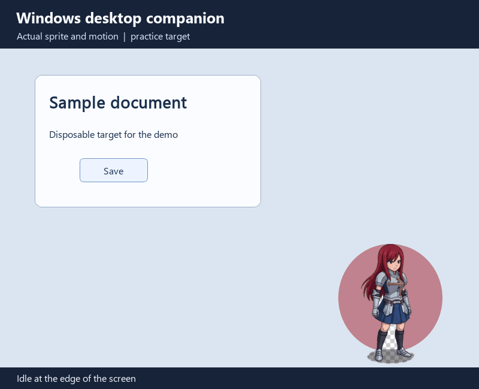
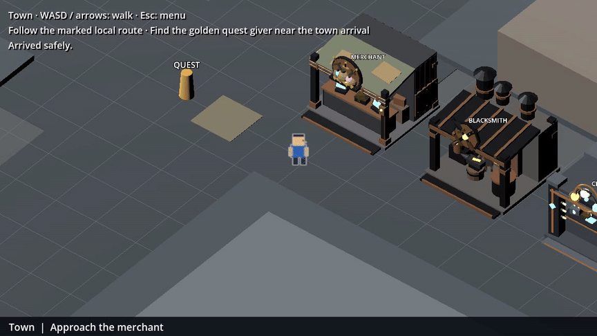

Applied AI project portfolio

I’m an early-career applied AI practitioner with approximately one year of hands-on experience and a Google AI Professional Certificate. I’m interested in AI evaluation, agent workflows, and AI-assisted software development, including OpenAI Emerging Talent opportunities.

My work includes defining requirements, directing agent handoffs, and reviewing results. The projects below distinguish those contributions from implementation by AI agents and collaborators.

Featured Projects

Windows AI Desktop Companion

An animated desktop character with speech input and playback, Ollama integration, and Windows desktop automation.

I brought the companion implementation into this portfolio for review. Attribution of specific code changes remains unresolved.

Reviewed source contains speech, model, and automation paths. The clip shows the actual sprite walking and pointing at a supplied practice target. Live target discovery, voice, and model calls were outside this capture.



[Read the voice interfaces case study](case-studies/voice-interfaces.md)

Multi-Agent Development Workflows

OpenClaw workflows coordinate scoped tasks, delegation, and handoffs across assistants, with human-directed requirements and review.

I defined shop behavior and persistence requirements, authorized reassignment after a stalled run, and made acceptance decisions.

Configuration and project records show separate workspaces and a documented handoff, timeout, and takeover. Agents implemented and validated the resulting changes. Runtime policy enforcement remains unverified.

[Read the agent workflows case study](case-studies/agent-workflows.md)

AI-Assisted Game Development

Godot prototypes explore gameplay systems, connected encounters, inventory, and persistent campaign state.

I set shop stock rules, encounter policy, visual approvals, and integration priorities. Assistants implemented campaign wiring and purchase persistence.

The in-game clip shows a merchant purchase and the sold-out offer after saving and loading in a fresh process. Project records also report prior automated checks. Balance and pacing still need human playtesting.



[Read the game development case study](case-studies/game-development.md)

Local LLM Evaluation

Ollama and LM Studio integrations support inference measurements and task-validation experiments in a separate game checkout.

My development machine and projects supplied the evaluation environment. A collaborator authored the original harness. My authorship of configuration changes and measured runs remains unverified.

Provider configuration, a recorded inference baseline, and a partial task run are available. The baseline reached its output cap, and the task evaluation is incomplete.

[Read the local inference case study](case-studies/local-inference.md)

Run the offline demonstrations

From the repository root, with Python 3.10 or later:

```sh
python demos/run.py all --verify
python -m unittest discover -s tests -v
```

The demonstrations use [synthetic inputs](configs/scenarios.json), the Python standard library, and offline checks. See the [demo guide](demos/README.md), [architecture diagrams](architecture.md), and [security and sharing notes](SECURITY.md).

Evidence labels

Source reviewed means inspected code or configuration supports the claim.

Recorded validation means a project artifact reports a result from the original project.

Showcase verified means an offline demo or test in this repository ran and passed.

Pending or unverified marks remaining work or a gap in the available evidence.
