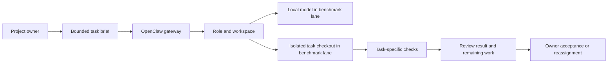
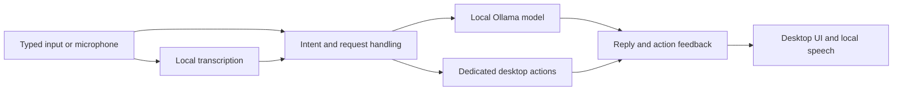
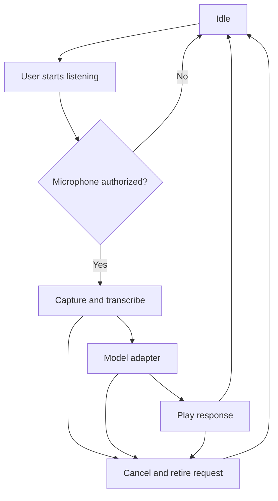
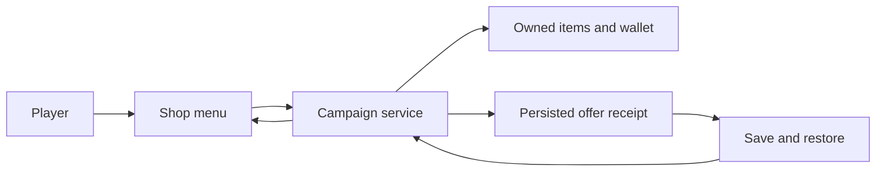

Architecture

Agent handoff and local evaluation

Observed pattern across the role configuration, project handoff, and evaluation harness. The benchmark uses a separate checkout and a local provider. Completion depends on evidence and review.

Windows voice companion

Source-observed components are shown at a high level. The Windows desktop and speech paths were inspected separately from Android.

Android voice interaction

Showcase design. The Android demo models these states with generated events.

Godot campaign service boundary

Observed division of responsibilities. The demo exercises the same engineering idea with independently written in-memory code and fictional offers.

