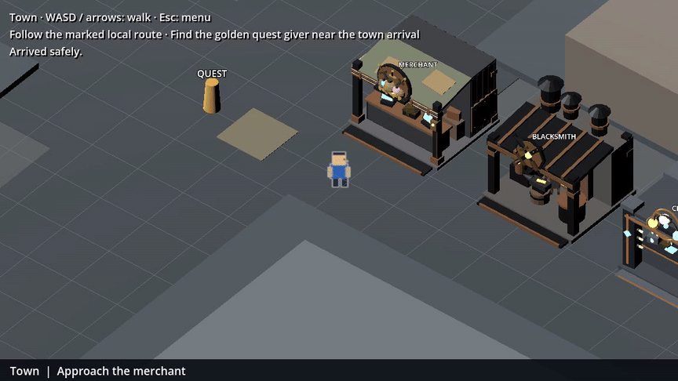

AI-assisted game development

This case study covers a Godot action-RPG prototype, a separate Godot campaign, and a Unity starter baseline.

My contributions

For the campaign, I set the one-copy shop rule and clarified that a player could own both an earned and a purchased copy of an item. Project records also credit me with visual approvals, encounter policy, integration priorities, and acceptance of the connected baseline. Git metadata attributes later inventory, merchant, and encounter changes in the prototype to my account. The Unity initial check-in is also recorded under my account.

AI-agent contributions

Project records attribute purchase receipt persistence, campaign wiring, and related validation to assistants. The Godot prototype also has a separately credited collaborator. Available Unity evidence does not establish a project-specific AI-assisted development workflow.

Verified results

Source review found a command-driven simulation, character setup, movement, and a training encounter in the Godot prototype. A later checkout has inventory, currency, a merchant, and an encounter with loot. The separate campaign shows connected travel, encounters, recovery, town services, and persistent progression. Prior project records report headless, rendered, and clean-checkout validation.

The Unity snapshot contains a starter scene and scripts for third-person control, collectibles, respawn, and motion audio. The [game demo](../demos/README.md) independently verifies a fictional one-time offer across a save/load round trip.

Merchant purchase and reload

This in-game capture uses an existing Godot playtest build and a fresh test save. Scripted controls walk to the merchant, buy the single available copy, and save through the pause menu. After a cut to a fresh game process, the merchant shows the same offer as sold out.

Remaining limitations

The audit reviewed existing files and test records. The in-game capture verified one purchase and reload scenario. Human playtesting for placement, balance, and pacing is still pending in the campaign records, along with chapter completion work. Commit metadata does not resolve individual human and AI coding contributions. Original authorship of Unity starter components, a finished Unity slice, and runtime AI in Unity remain unverified.
