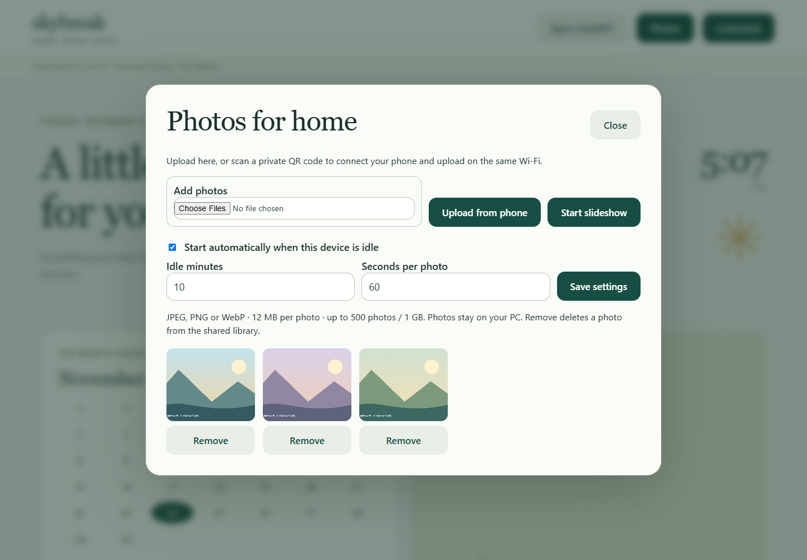
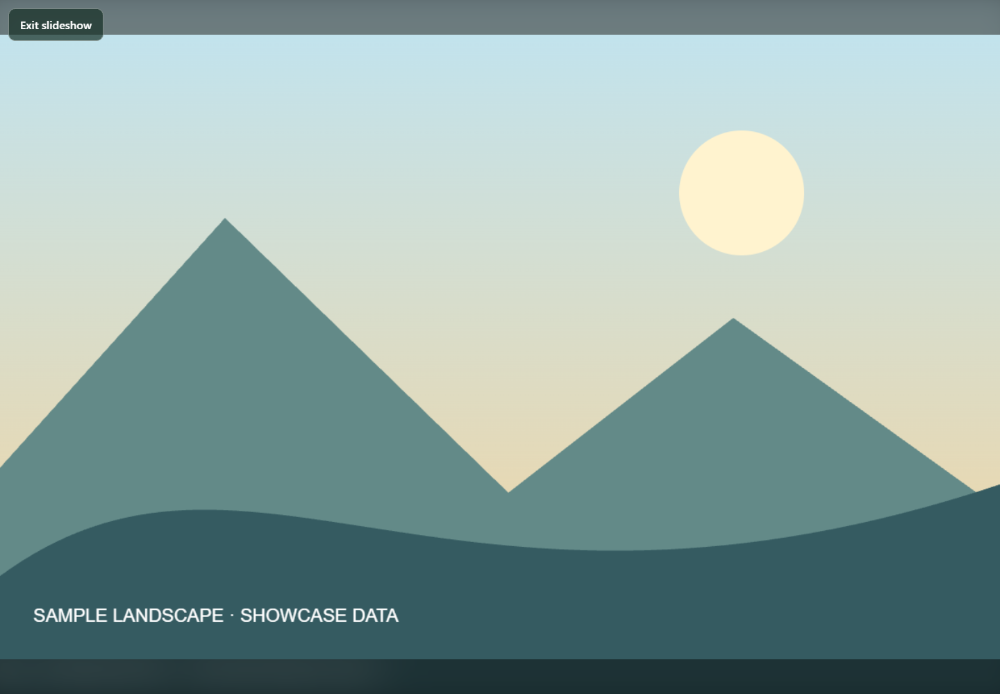
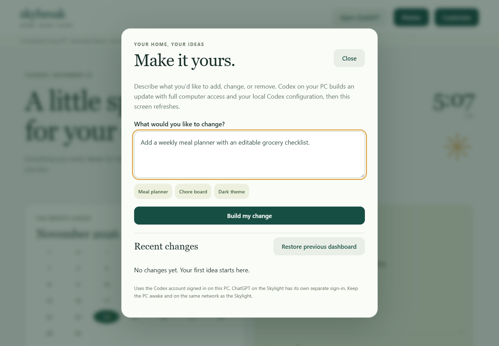

Skybreak: AI-assisted home display

Skybreak adapts an owner-operated Android home display into a household hub with a native home screen, an offline chore board, photo playback, scheduled display sleep, and a PC-backed dashboard. Its applied AI component lets the owner request dashboard changes in natural language and receive an explicit implementation result.

My contributions

I own the project and provide its household-use direction and review. This showcase presents the resulting product and engineering decisions. The available project materials do not establish line-by-line human authorship or a complete history of my acceptance decisions.

AI-agent contributions

The customization workflow delegates requested changes to a Codex coding session. The implementation separates a reported result from actual changes, validates dashboard assets before publication, and retains a previous dashboard version. Project documentation records AI-assisted implementation and validation work across the dashboard and Android integration; individual coding contributions are not independently attributed here.

Verified results

Source reviewed: the dashboard engine stages editable assets, requires a structured implementation result, rejects unchanged builds, and checks assets before publishing a new version. Supporting-code changes can be reported separately, including changes that need a service restart. Restoring the previous dashboard switches the displayed assets; it does not reverse every supporting change.

Source reviewed: the native chore board saves its state locally using atomic writes. Its documented behavior includes recurring chores, per-person completion, star awards, persistent rewards, backup/restore, and administrator-controlled corrections. Native home navigation and chore tracking can operate without the PC; dashboard customization and photo delivery depend on the PC service.

Recorded validation: project records report 36 chore-model checks and 23 chore-UI checks, covering calendar boundaries, repeated completion, rewards, undo, recovery, and persistence. Separate records report 15 sleep-schedule checks, including a real display-off/display-on cycle, and 14 idle-photo checks, including launches over other screens and timer reset after touch. Navigation records report 15 recent-app checks. These are distinct, previously recorded suites, not new portfolio test runs or a combined coverage score.

Recorded validation: the project documents a customization exercise that created a working counter and a supporting module, checked them, and published the dashboard. Photo records also document physical-device review of gallery and immersive slideshow display. Raw records and household media remain private.

Dashboard captures

These screenshots show the actual dashboard interface running in an isolated browser fixture. The images are generated sample landscapes, notes are synthetic, and the request history is empty. The fixture has no household library, live pairing, account connection, or device access.

The photo panel exposes local upload, phone-upload entry, idle timing, and slideshow controls. No phone-upload link or QR code was generated for this capture.

The slideshow capture shows the real playback interface preserving the sample image's proportions.

The Codex integration capture shows request entry and dashboard recovery controls. The sample request was not submitted. It demonstrates the interface, not a new model call, completed build, or recovery test.

Engineering decisions

Keep essential household functions on the device so chore tracking and native navigation remain useful when the PC is unavailable. Use explicit change detection and validation so a successful AI process exit alone cannot mark a request as implemented. Preserve a previous dashboard for recovery while clearly describing the limits of that recovery.

The speech prototype combines local recognition and synthesis with an optional text-model connection. Its project documentation distinguishes local speech checks from successful account authorization and model inference. This distinction prevents a component test from being presented as a complete voice-assistant demonstration.

Remaining limitations

This review inspected selected source and existing documentation and captured the interface with synthetic data. It did not rerun hardware tests or independently reproduce the recorded device or AI-build outcomes. Validation of dashboard assets does not prove complete feature correctness or establish a security boundary for the coding agent.

The speech documentation reports an unresolved account-authorization exchange and no confirmed model inference. Full spoken conversation, live microphone performance in room noise, and wake listening across other apps remain unverified. Physical reboot recovery is also unverified in the reviewed device records. The calendar view is not yet connected to a calendar provider.

Sharing boundary

This case study contains independently written prose and reviewed screenshots with synthetic content. Implementation code, capture scripts, executable demos, device-control instructions, connection details, authentication material, signing assets, private paths, logs, and household data are excluded. No source archive or physical-device screenshots accompany it.
