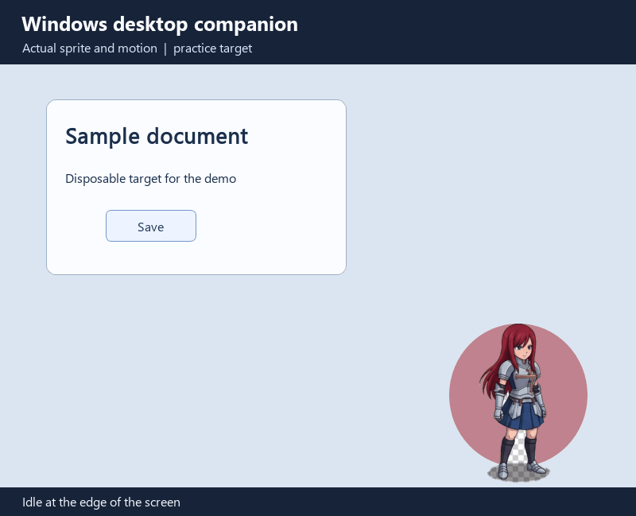

Voice interfaces

This case study covers a Windows desktop companion and a separately reported Termux voice setup on Android.

My contributions

I identified the Windows companion implementation and the Android Termux setup for review. The available Windows source provides evidence of the project work. Attribution of specific code changes to me is unresolved.

AI-agent contributions

The Windows source contains an Ollama-backed response path. Dedicated Windows automation handles desktop actions. Historical records are insufficient to attribute specific development changes to an AI coding agent.

Verified results

The Windows source review found typed input, microphone transcription, speech playback, avatar state, Ollama requests, and dedicated Windows UI Automation. The reviewed material describes a stricter requirement for clicks than for estimated pointing. Regression test files are present.

The [desktop demo](../demos/README.md) verifies generated target decisions, including denial of ambiguous and screenshot-only click requests. The separate voice demo verifies permission denial, cancellation, and stale response rejection using generated request events.

Companion in motion

The capture shows the Windows companion's sprite, movement, and pointing code. A disposable window supplied the target coordinates. Target discovery, microphone input, and model calls were outside this capture.

Remaining limitations

The full Windows launcher, microphone, and live desktop automation were outside the audit. The Android setup is user-reported and remains unverified because device-side Termux scripts were unavailable. The Android diagram and voice demo are proposals. They provide no evidence of the device’s microphone commands, model routing, or response playback.
